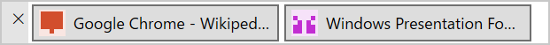
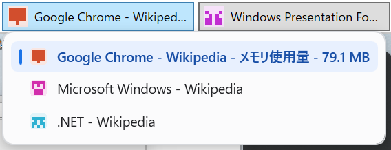

# Chrome Taskbar


開いている Chrome のウィンドウを、ボタンにして 1 本のバーに並べる Windows アプリです。

Chrome のウィンドウをたくさん開いていると、Windows のタスクバーではどれがどれだか分かりにくくなります。Chrome Taskbar は 1 ウィンドウを 1 ボタンにして並べ、ボタンにマウスを乗せるとそのウィンドウのタブ一覧を表示します。



ボタンにマウスを乗せると、そのウィンドウのタブ一覧が出ます。



## できること

- **ウィンドウを一覧する**: 起動中の Chrome ウィンドウが 1 つずつボタンになります。ボタンにはタイトルと、先頭タブのタイトルから作った模様のアイコンが付くので、見た目で区別できます。
- **ウィンドウを切り替える**: ボタンをクリックすると、そのウィンドウが前面に出ます。すでに前面にあるウィンドウのボタンを押すと最小化します。
- **タブを確認・選択する**: ボタンにマウスを約 0.5 秒乗せると、そのウィンドウのタブ一覧がポップアップで出ます。タブをクリックすると、そのウィンドウを前面に出してそのタブに切り替えます。
- **バーを好きな場所に置く**: バーの端にあるつまみ（灰色の部分）をドラッグして移動し、ふちをドラッグして大きさを変えられます。位置と大きさは次に起動したときも引き継がれます。

マウスを乗せるだけでは、Chrome 側は何も変わりません（前面に出たりタブが切り替わったりしません）。

Chrome 拡張機能のインストールや、管理者権限は要りません。Windows の標準機能（UI Automation）を使って Chrome の画面からタブを読み取っています。

## 必要なもの

- Windows 10 / 11
- [.NET 10 SDK](https://dotnet.microsoft.com/download)
- Google Chrome

## 実行する

1. このリポジトリを取得します。

   ```powershell
   git clone <このリポジトリの URL>
   cd chrome-taskbar
   ```

2. ビルドします（初回だけ。コードを変えたときもやり直します）。

   ```powershell
   dotnet build ChromeTaskbar.sln
   ```

3. Chrome を起動しておき、アプリを実行します。

   ```powershell
   dotnet run --project src/ChromeTaskbar.App
   ```

バーが表示され、開いている Chrome ウィンドウがボタンとして並びます。Chrome Taskbar が Chrome を起動することはありません。

**終了するとき**は、つまみの部分にある「✕」ボタンを押します。

### うまく動かないとき

- **起動するとすぐエラーになる**: 手順 2 のビルドが済んでいない可能性があります。`dotnet build ChromeTaskbar.sln` を実行してからもう一度起動してください。このアプリは本体と補助プログラム（`ChromeTaskbar.UiaWorker.exe`）の 2 つで動いていて、補助プログラムが見つからないと起動できません。場所を指定する場合は `dotnet run --project src/ChromeTaskbar.App -- --worker <ChromeTaskbar.UiaWorker.exe のパス>` とします。
- **タブ一覧が出ない**: タブの読み取りに失敗しても、ウィンドウの一覧と切り替えはそのまま使えます。タブが非常に多いウィンドウでは、読み取りが途中で打ち切られて一覧が出ないことがあります。
- **Chrome 以外のものがボタンになる**: Chrome のアプリ版ウィンドウ（PWA）や、別ウィンドウで開いた DevTools も Chrome のウィンドウとして表示されることがあります。

## 開発者向け

テストの実行:

```powershell
dotnet test ChromeTaskbar.sln
```

構成、仕組み、既知の制限など詳しい情報は [docs/README.md](docs/README.md) にあります。

## ライセンス

[MIT License](LICENSE)
