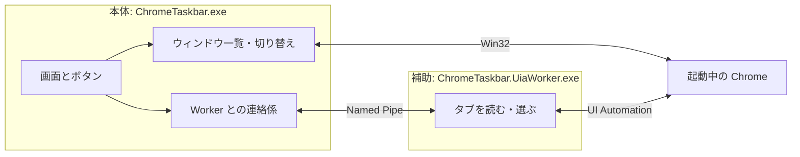
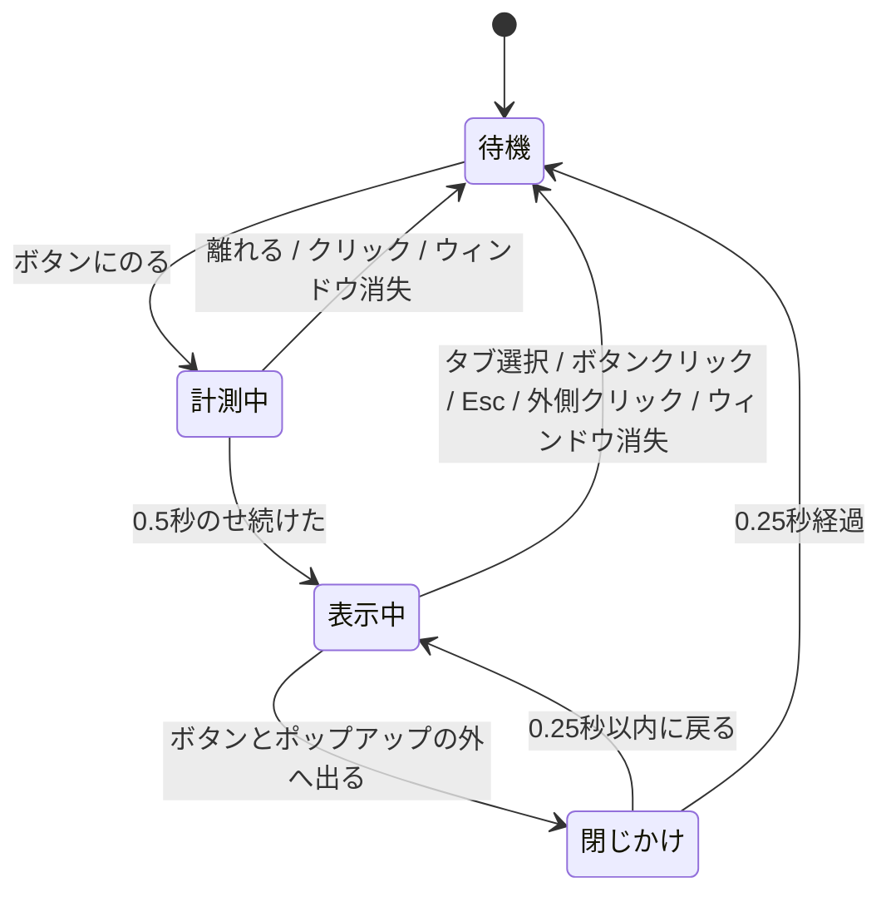

# Chrome Taskbar 設計ガイド（読みやすい版）

> 元資料: [chrome-taskbar-architecture.md](chrome-taskbar-architecture.md)（正式な仕様はこちら。数値や IPC の厳密な定義は原本を参照）
> 作成日: 2026-11-06 / 状態: 設計案。まだ実装も実機検証もしていない

---

## 1. ひとことで言うと

**起動中の Chrome ウィンドウをボタンで並べる、専用の小さなタスクバー**を作る。

- ボタンをクリック → その Chrome ウィンドウに切り替わる（もう一度押すと最小化）
- ボタンにマウスを0.5秒のせる → そのウィンドウのタブ一覧がポップアップする
- タブをクリック → そのタブに直接切り替わる

条件は **「Chrome 拡張機能を入れないこと」**。そのため、Chrome の内部 API ではなく、Windows が持つ仕組みだけで Chrome を外から操作する。

## 2. 使う技術と、その理由

| やりたいこと | 使う技術 | ひとこと説明 |
|---|---|---|
| アプリの画面 | C# / WPF | Windows 標準のデスクトップ UI |
| Chrome ウィンドウの一覧・切り替え | Win32 API | ウィンドウを列挙・前面化する Windows の基本機能 |
| タブの一覧取得・選択 | UI Automation（UIA） | 本来はスクリーンリーダー向けの「画面の中身を読む」仕組み。Chrome は公式に対応している |

ウィンドウ切り替えの部分は、兄弟プロジェクト `vscode-selector`（VS Code 用の同様のツール）のコードをほぼそのまま流用する。

### ⚠️ 最大の不確定要素

UIA で **本当に全部のタブが取れるかは、まだ確かめていない**。特に次の状況が怪しい。

- Chrome が最小化されているとき
- タブグループが折り畳まれているとき
- タブが多くて画面外にはみ出しているとき

そこで、本格的に作り始める前に **試作（PoC）で確認する** ことを必須条件にしている（→ §10）。

## 3. ユーザーから見た動き

| こうすると | こうなる |
|---|---|
| アプリを起動 | 今開いている Chrome ウィンドウがボタンとして並ぶ（Chrome を新たに起動はしない） |
| 裏にある／最小化中のウィンドウのボタンを押す | そのウィンドウが手前に出る |
| すでに手前にあるウィンドウのボタンをもう一度押す | そのウィンドウが最小化される |
| ボタンにマウスを約0.5秒のせ続ける | タブ一覧のポップアップが開く |
| マウスをのせるだけ | Chrome 側には何も起きない（勝手に手前に出たりしない） |
| ポップアップのタブを押す | Chrome が手前に出て、そのタブが選ばれる |
| ボタンからポップアップへマウスを移す | ポップアップは閉じずに残る |
| 外へ出る・Esc・外側をクリック | ポップアップが閉じる |
| タブが取れなかった | 「タブを取得できません」と表示。ウィンドウ切り替えは普通に使える |
| Chrome やタブが閉じられた | 一覧が自動で更新される |

### 対象になるウィンドウ

- 自分と同じ Windows ユーザーで動いている Chrome すべて（複数ウィンドウ・複数プロファイルも OK、事前設定は不要）
- 別の仮想デスクトップにあるウィンドウは出さない
- ダイアログや非表示ウィンドウは出さない
- PWA（アプリ化したサイト）や独立 DevTools は、見分けがつかずボタンとして出ることがある。その場合タブ機能は「使えない」と表示するだけ
- シークレットウィンドウも出ることがある。種類を推測してラベルを付けたりはしない。タイトルはメモリー上にしか持たない（保存しない）

## 4. 全体の構成

アプリは **2つのプロセス** に分かれている。

**なぜ分けるのか？**
UIA の呼び出しは、相手（Chrome）の状態によっては **固まって返ってこない** ことがある。しかも途中で中断できない。本体の中で呼ぶと、タスクバー全体がフリーズしてしまう。

そこで UIA の処理は別プロセス（Worker）に任せ、固まったら **Worker ごと強制終了して作り直す**。本体の画面とウィンドウ切り替えは影響を受けない。

- Worker は本体が起動・終了を管理する。管理者権限には昇格しない
- 本体は「どのウィンドウか」を HWND（Windows のウィンドウ番号）で Worker に伝える。Chrome 内部のウィンドウ ID とひも付ける必要はない

## 5. 主な部品

| 部品 | 役割 |
|---|---|
| `MainWindow` / `TaskbarViewModel` | ボタンの表示・並び順・クリック処理 |
| `HoverController` | マウスがのっている時間を測り、ポップアップを開く/閉じる |
| `TabPopupViewModel` | タブ一覧の表示・スクロール・「取得中」などの表示 |
| `WindowRegistry` | Chrome ウィンドウの出現・消失を追跡 |
| `Win32WindowEnumerator` / `ChromeWindowFilter` | Windows のウィンドウ一覧から Chrome だけを抜き出す |
| `WindowActivator` | 最小化からの復元、前面化、最小化 |
| `UiaWorkerBroker` | Worker の起動・通信・タイムアウト・再起動 |
| `ChromeUiaTabProvider`（Worker 側） | UIA で Chrome のタブを探す・選ぶ |
| `TabSnapshotCache` | 取ったタブ一覧を短時間だけ覚えておく |

開発環境は C# / .NET 10。UIA は .NET 標準の `System.Windows.Automation` を使い、外部ライブラリには頼らない。

## 6. vscode-selector から何を流用するか

| 既存の部品 | 扱い |
|---|---|
| 枠なしウィンドウ、ドラッグ、リサイズ、縦横配置 | そのまま流用。ホバー機能を追加 |
| ウィンドウ列挙・変更通知・定期チェック | 流用 |
| ウィンドウフィルター | 対象を `chrome.exe` に変更 |
| 前面化・最小化の処理 | 流用。成功確認を強化 |
| 「直前に手前にあったウィンドウ」の追跡 | 流用（再クリック時の最小化判定に使う） |
| 時計（テスト用の仮想時計含む） | 流用。ホバー時間の計測にも使う |
| 画面からはみ出さない位置補正 | 流用。ポップアップと DPI 混在に拡張 |
| タイトル解析・WSL パス・フォルダーを開く | VS Code 専用なので使わない |

`vscode-selector` は MIT ライセンス。流用時はライセンス表記を残す。

## 7. ウィンドウ一覧の作り方

1. Windows の全トップレベルウィンドウを列挙する
2. 「表示されている」「ダイアログではない」「別の仮想デスクトップではない」ものに絞る（最小化中は残す）
3. ウィンドウの種類名が `Chrome_WidgetWin_1` **かつ** プロセスが `chrome.exe` のものだけ採用する
   - 種類名だけだと VS Code や Edge も混ざるため、両方を確認する
   - タイトルが Chrome っぽいだけでは採用しない
4. 変化があった分だけ一覧を更新する

### 細かい配慮

- **ボタンの並び順は「見つけた順」で固定**。タイトルが変わってもボタンが動き回らない
- 同じタイトルが並ぶときは連番を付ける
- タブ数は取れたときだけ表示。取れなかったのを「0件」とは表示しない
- **ウィンドウ番号の使い回し対策**: Windows はウィンドウが閉じると番号を別ウィンドウに再利用することがある。そこで「ウィンドウ番号＋プロセス番号＋プロセス起動時刻＋世代番号」の組で識別し、クリック時にも本物か再確認する（それでも完全には防げないことは認めている）
- 変化の検知は Windows のイベント通知が基本。取りこぼし対策として、2秒ごと（バー最小化中は10秒ごと）に一覧を取り直す

## 8. タブの取り方

### Chrome の画面からタブを探す

- 対象ウィンドウの UIA ツリー（画面部品の木構造）をたどり、「タブ列」と「タブ」を探す
- **Web ページの中身は探さない**。ページ内にも「タブ」風の部品があり、それと混同しないため
- 探索には上限がある（部品 1000 個・深さ 12・0.75 秒）。上限に達したら「不完全」として扱い、途中までの一覧を完全なものとして見せない
- 画面外のタブも捨てない
- タイトル文字列や画面座標のクリックには頼らない（言語やレイアウトが変わると壊れるため）

### タブの「目印」

- Worker はタブごとに **使い捨ての目印（TabToken）** を発行し、本体はそれを使ってタブを指定する
- タブのタイトルや「左から何番目」は目印にしない（同名タブや並べ替えで間違えるため）
- 次のときは目印を無効にする: Worker の再起動、一覧の取り直し、タブの消失、有効期限切れ
- 無効になった目印を「たぶんこれだろう」と別のタブに付け替えることはしない

### 鮮度の管理

- 古いリクエストへの応答が後から届いても捨てる
- ポップアップを開いている間だけ、1秒ごとに取り直す（裏のウィンドウを常に読み続けることはしない）
- 覚えておくのは最大 8 ウィンドウ分・5 秒まで。古い情報を表示している間はクリックできないようにする

## 9. クリックしたときの動き

### ウィンドウボタン

「押す前にそのウィンドウが手前にあったか」で動きを変える。

| 押す前の状態 | 押した結果 |
|---|---|
| 手前にある | 最小化する |
| 裏にある | 手前に出す |
| 最小化中 | 元に戻して手前に出す |

例: 手前の A を押す → 最小化 → もう一度押す → 復元。裏の B を押す → 手前に → もう一度押す → 最小化。

**注意点**: ボタンを押した瞬間、タスクバー自身が手前に来てしまう。そのため「今の手前のウィンドウ」ではなく、**押す直前に手前だったウィンドウ** を記録しておいて判定する。

手前に出す処理は「成功した」という戻り値を信用せず、最後に本当に手前になったか確認する。失敗したら表示で知らせる。強引な前面化テクニック（キー送信など）は、まず普通の方法で試してから必要な分だけ加える。

### タブボタン

1. Chrome を復元・手前に出す（**すでに手前でも最小化はしない**。ウィンドウボタンとは別の動き）
2. Worker に「このタブを選んで」と頼む
3. Worker はそのタブがまだ存在するか確認してから、UIA の「選択」操作を行う
4. 本当に選ばれたか読み直して確認する
5. 成功ならポップアップを閉じる。失敗なら一覧を取り直してメッセージを出す

やらないこと:
- タブの閉じるボタンを誤って押す可能性のある操作
- `Ctrl+数字` キーや座標クリックでの代用
- 失敗時の自動リトライ（ユーザーが意図しないタイミングでタブが切り替わるのを防ぐ）

## 10. ホバーとポップアップ

- マウスがのった時点でタブの取得を先に始めておく。ただし0.5秒たつまでは開かない
- 0.5秒たってもまだ取れていなければ「取得中」と表示
- A から B のボタンへ移ったら、A を閉じて B の計測を最初から始める
- ポップアップは同時に1つだけ。開いてもフォーカスを奪わない（作業中の入力を邪魔しない）
- 画面の端やモニターをまたいでもはみ出さないよう位置を補正する（DPI の違うモニターにも対応）
- タブが多い場合はスクロールできるリストにする
- **最小化中で取れないからといって、勝手にウィンドウを復元して取りにいくことはしない**

## 11. Worker との通信

- 本体が毎回ランダムな名前の Named Pipe（プロセス間通信の通り道）を作り、Worker を非表示で起動する
- 接続してきたのが本当に自分が起動した Worker か確認する（同じユーザー・同じセッション・同じプロセス番号）
- メッセージは「長さ＋JSON」。大きな数値（ウィンドウ番号など）は丸め誤差を防ぐため **文字列** で送る

主なメッセージ:

| メッセージ | 意味 |
|---|---|
| `Hello` | 接続直後のあいさつ（プロトコル版と Worker の世代番号） |
| `ReadTabs` | 「このウィンドウのタブ一覧をちょうだい」 |
| `SelectTab` | 「このタブを選んで」 |
| `Invalidate` | 「このウィンドウはもう無いから忘れて」 |
| `Cancel` | 「さっきの依頼、まだ始めてないなら取り消して」 |
| `Result` | 結果（成功／古い／使えない／不完全／ウィンドウ消失／前面化失敗／時間切れ など） |

壊れたメッセージを受け取ったら、その接続は切って Worker を作り直す。同じ依頼を勝手に再送はしない。

### 失敗したときの振る舞いまとめ

| 何が起きた | どう守る | 画面の表示 |
|---|---|---|
| 通信データが壊れている | 切断して Worker を作り直す | 再接続中 |
| タブ探索が上限に達した | 途中までの一覧は捨てる | 完全な一覧を取得できません |
| Worker が固まった | 時間切れ（読取 1.5 秒／選択 2 秒）で強制終了・作り直し | 再接続中 |
| 古い応答が届いた | 無視する | 今の表示のまま |
| 対象のタブ／ウィンドウが消えた | 選択せず目印を破棄 | 一覧が更新されました |
| Chrome を手前に出せなかった | タブ選択を送らない | Chrome を前面にできません |

Worker の作り直しが続けて失敗する場合は、1秒 → 5秒 → 30秒と間隔を空け、それでもダメなら「再試行」ボタンを出す。

**大事な原則**: タブ機能が壊れても、ウィンドウ一覧と切り替えは動き続ける。ただし、それで「要件を満たした」とはみなさない。

## 12. 主な設定値

| 名前 | 値 | 意味 |
|---|---:|---|
| `HoverDelay` | 500ms | ポップアップが開くまでのホバー時間 |
| `PopupCloseGrace` | 250ms | 外へ出てから閉じるまでの猶予 |
| `WinEventDebounce` / `WinEventMaxWait` | 100ms / 500ms | ウィンドウ変化通知のまとめ方 |
| `VisiblePollInterval` / `MinimizedPollInterval` | 2秒 / 10秒 | 定期的な一覧の取り直し間隔 |
| `PopupRefreshInterval` | 1000ms | ポップアップ表示中のタブ再取得間隔 |
| `TraversalNodes` / `Depth` / `Time` | 1000個 / 12階層 / 750ms | タブ探索の上限 |
| `ReadDeadline` / `SelectDeadline` | 1500ms / 2000ms | Worker の応答待ち上限 |
| `CacheWindowLimit` / `CacheTtl` | 8件 / 5秒 | タブ一覧を覚えておく量と期間 |
| `MaxTabs` / `MaxTitleUnits` / `MaxFrameBytes` | 512 / 1024文字 / 4MiB | 通信で扱う上限 |
| `Backoff` | 1秒 / 5秒 / 30秒 | Worker 再起動の待ち時間 |

各値は「ちょうど境界の前・境界・後」の3パターンで自動テストする（例: 999ms では開かない、1000ms・1001ms では開く）。

## 13. 設計判断のまとめ

| 選んだ方針 | 理由 | 選ばなかった案 |
|---|---|---|
| UIA ＋ 別プロセス Worker | 拡張機能不要。固まっても本体は無事 | Chrome 拡張: 「拡張なし」という条件に反する |
| ウィンドウ番号＋世代＋目印で識別 | 番号の使い回しや同名タブでの誤操作を防ぐ | タイトルや位置: 並べ替えや重複で狂う |
| 上限に達したら「不完全」と表示 | 欠けた一覧を完全と思わせない | 途中で切って表示: 欠落に気づけない |
| クリックしたときだけ前面化 | ホバーで作業を邪魔しない | ホバーで復元: ユーザーの作業を中断する |
| 固まったら Worker を作り直す | 中断できない UIA から回復できる | 待ち続ける: タブ機能が止まったままになる |

## 14. 作り始める前に確かめること（PoC）

**PoC 1〜4（下表の AC-01〜04 相当）に合格しない限り、本実装には進まない。現時点では未実施。**

| 確認項目 | 試す状況 | 合格の条件 |
|---|---|---|
| AC-01 接続 | 普通の Chrome、複数ウィンドウ・プロファイル | 設定を変えずにウィンドウとタブが取れる |
| AC-02 完全性 | 裏、最小化、画面外、大量、固定タブ、折り畳みグループ | 実物と全タブが一致し、読むだけで Chrome が動かない |
| AC-03 取り違え | 同名タブ、並べ替え、移動、閉じる | 正しいタブを選ぶ。怪しいときは推測で選ばない |
| AC-04 復元 | 裏、最小化、最大化、バーが手前 | 手前に出してタブ選択まで完了する |
| AC-05 再クリック | 手前、裏、最小化 | それぞれ最小化、前面化、復元になる |
| AC-06 タブクリック | 手前の Chrome のタブを押す | 最小化せずにタブが切り替わる |
| AC-07 ホバー | 0.5秒の境界、A→B 移動、離脱、遅い応答 | 早く開かず、取り消した応答では開かない |
| AC-08 ポップアップ | 移動、外側、Esc、更新中 | クリックでき、古い応答で開き直さない |
| AC-09 Worker | 固まる、終了、再起動 | 本体は動き続け、古い目印は拒否される |
| AC-10 表示 | DPI 混在、複数モニター、画面端、縦横配置 | 画面内に収まりスクロールできる |
| AC-11 表示の違い | 日本語/英語、通常/シークレット、PWA/DevTools | 誤認識せず、非対応ははっきり表示する |
| AC-12 負荷 | 重い大量タブ、連続ホバー、長時間 | 際限のない探索・処理の溜まり・メモリー増加がない |

### 判定ルール

- 各ケースで Chrome のバージョン、Windows のビルド、DPI、言語、ウィンドウ状態、期待タブ数、実際に取れた数、所要時間、結果を記録する
- **合格（Pass）** = 数が一致し、勝手な復元・前面化・グループ展開がなく、選択したタブが実際に表示されている
- 一部しか取れない → 不合格（Fail）。試せなかった → 保留（Blocked）。どちらも合格扱いにしない
- 不合格なら、取れない条件を明記したうえで、別の方式（MSAA / IAccessible2）を調べて方針を見直す
- 自動テストは実機での確認の代わりにはならない

## 15. 今回やらないこと

- 実装そのもの、パッケージ化、配布
- 設定やデータの保存
- Chrome 拡張機能、Native Messaging の登録
- Chrome をデバッグモードで起動する・Chrome の設定を変える
- 管理者権限への自動昇格、Chrome の強制終了
- プロファイルやシークレットの判別
- PWA / DevTools と通常ウィンドウの正確な区別
- VS Code 専用機能（タイトル解析・WSL パス・フォルダーを開く）
- PoC での確認前に「全タブを取れる」と保証すること
