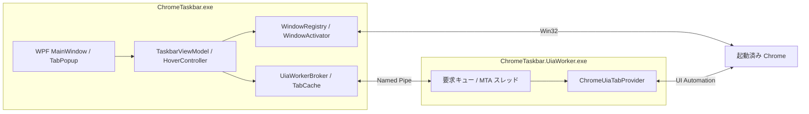
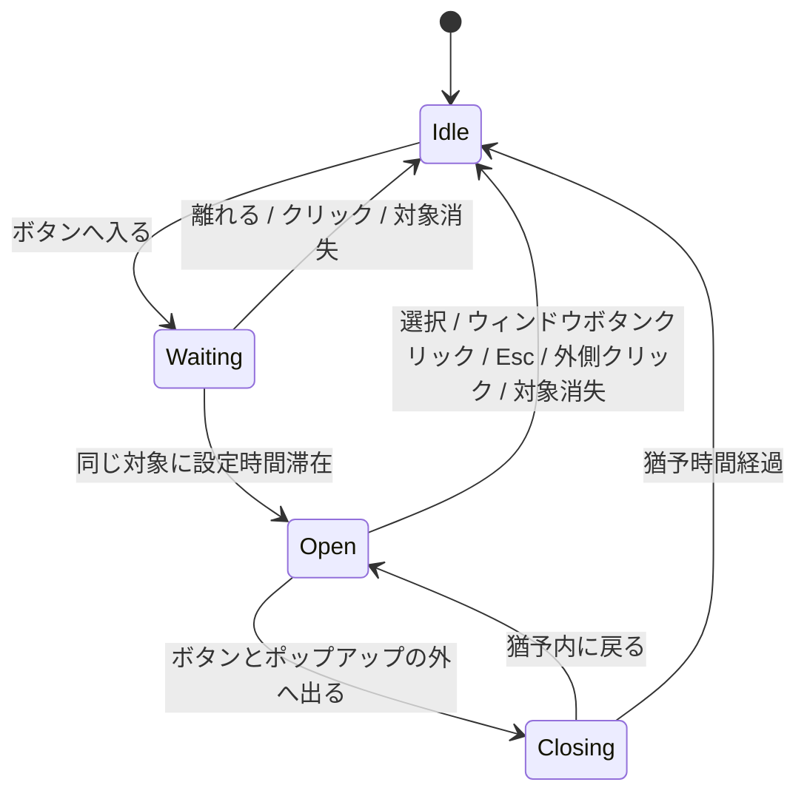

# Chrome Taskbar アーキテクチャ設計

作成日・改訂日: 2026-11-06 / 状態: 実装済み・PoC（AC-01〜04）は Pass、受け入れ（AC-05〜12）の一部は実機未検証（Blocked）。詳細は証跡 JSON を参照

## 1. 決定事項

ユーザーの「Chrome 拡張機能を入れない」という条件に合わせ、**C# / WPF ＋ Win32 ＋ Windows UI Automation（UIA）** を採用する。以前の拡張機能・Native Messaging を前提とする設計は、この改訂で置き換える。

- ウィンドウ一覧・復元・前面化・再クリック時の最小化: `vscode-selector` の Win32 実装を流用する。
- タブの取得・選択: 対象 Chrome ウィンドウの UIA ツリーを操作する。
- ホバーとタブボタン表示: WPF で実装する。
- UIA 呼び出し: 同梱する補助プロセス内で行い、ハングをメイン UI から隔離する。

Chrome は Windows UIA を公式にサポートしている。ただし、**現在の Chrome が最小化中・折り畳みグループ内・画面外の全タブを公開するかは未検証**。UIA の採用可能性と、このアプリの全要件を実現できることを区別し、§11 の PoC を本実装への進行条件とする。[Chrome の UIA 対応](https://developer.chrome.com/blog/windows-uia-support)

## 2. ユーザー向け動作

| 操作・状態 | 動作 |
|---|---|
| 起動 | 現在のデスクトップで列挙できる Chrome のトップレベルウィンドウを並べる。Chrome 自体は起動しない |
| 背面・最小化中のウィンドウボタンをクリック | 対象 Chrome を復元・前面化する |
| 既に前面のウィンドウボタンを再クリック | ベースと同じく対象 Chrome を最小化する |
| 同じボタンに連続してホバー | `HoverDelay` 後にそのウィンドウのタブボタンをポップアップする |
| ホバーのみ | Chrome の前面化・復元・タブ選択・グループ展開は行わない |
| タブボタンをクリック | その Chrome を復元・前面化し、対象タブを選択する |
| ボタンからポップアップへ移動 | ポップアップを保持してタブをクリックできるようにする |
| 外へ出る・Esc・外側クリック | ポップアップを閉じる |
| UIA が取得できない | 「タブを取得できません」と表示。ウィンドウのクリック切り替えは継続する |
| Chrome 終了・タブ終了 | 一覧を更新し、消失した対象への操作を中止する |

対象は同一 Windows ユーザー・同一ログオンセッションの Chrome。複数ウィンドウ・複数プロファイルを同じ仕組みで扱い、プロファイルごとの準備は不要。別の仮想デスクトップにある DWM cloaked ウィンドウは、ベースと同じく一覧から除外する。

通常ウィンドウ・最小化ウィンドウを対象にし、owner 付きダイアログ、tool window、不可視ウィンドウは除く。PWA や独立 DevTools 等は Win32 の判定だけでは通常ブラウザーと区別しきれないため、Chrome のトップレベルウィンドウとして表示される場合がある。タブストリップが確認できない場合はタブ操作を提供せず、取得失敗と「タブが 0 件」を混同しない。

シークレットウィンドウも同じ列挙対象になり得る。UIA からプロファイル名やシークレット種別を確実に取得できる前提を置かず、種別を推測したラベルや不確実な除外設定は設けない。表示に使うタイトルはメモリー内だけに保持する。

## 3. 全体構成



メインアプリはウィンドウごとの HWND を管理し、タブ取得時にその HWND を Worker に渡す。Worker が `AutomationElement.FromHandle(hwnd)` からタブストリップを調べるため、Chrome の独自 windowId と HWND を対応付ける処理は不要。

Worker は Chrome が起動する Native Messaging Host ではなく、**本アプリが起動・終了を管理するローカルの補助プロセス**。通常権限で起動し、自動昇格は行わない。

## 4. モジュールと技術

| モジュール | 責務 |
|---|---|
| `MainWindow` / `TaskbarViewModel` | ウィンドウボタン、表示順、状態、クリック |
| `HoverController` | 滞在時間、取消、ポップアップ対象の世代管理 |
| `TabPopupViewModel` | タブ一覧、スクロール、操作不可・再取得の表示 |
| `WindowRegistry` | HWND の検証、ウィンドウの出現・消失、差分反映 |
| `Win32WindowEnumerator` / `ChromeWindowFilter` | Chrome のトップレベルウィンドウ列挙 |
| `WindowActivator` | 対象再検証、最小化からの復元、前面化、再クリック時の最小化、結果確認 |
| `UiaWorkerBroker` | 補助プロセスの起動、IPC、要求期限、停止・再起動。任意の `diagnostics` シンク（既定 `Trace.TraceError`）と `LastDiagnostic` で障害を通知し、シンク例外は握りつぶす |
| `ChromeUiaTabProvider` | UIA タブストリップ探索、取得、選択、選択状態確認 |
| `TabSnapshotCache` | HWND ごとの取得結果、鮮度、失効、最大件数 |

WPF と Worker は C# / `net10.0-windows`、Worker は `System.Windows.Automation` を使う。UIA パターン対応は PoC で確認し、外部自動化ライブラリは必須にしない。

## 5. vscode-selector の流用範囲

隣接 `vscode-selector` の実ソースを参照する（未移植）。

| 既存ファイル・機構 | 方針 |
|---|---|
| `MainWindow.xaml` / `.xaml.cs` | 枠なし UI、ドラッグ、リサイズ、縦横配置を流用。Chrome ボタンとホバーを追加 |
| `Win32WindowEnumerator.cs` | 列挙と Win32 観測処理を流用 |
| `WindowFilter.cs` | 許可プロセスを `chrome.exe` に変更。タイトルだけによる採用はしない |
| `WindowActivator.cs` / `IForegroundApi.cs` | HWND・PID・クラスの再検証と復元・前面化・TryMinimize を流用。状態確認と期限付き実行を補強 |
| `WinEventChangeNotifier.cs` / `UpdateScheduler.cs` | 変更通知、debounce、定期列挙を流用 |
| `ForegroundTracker.cs` | 外部のアクティブウィンドウ表示と、クリック前の前面ウィンドウの判定に流用。再クリック時の最小化に使用する |
| `IClock.cs` | 単調増加時計と仮想時計をホバーにも使用 |
| `ProjectEntryDiff.cs` | 差分更新を WindowKey 向けに変更 |
| `LayoutMath.cs` | 画面内補正を流用し、ポップアップと混在 DPI に拡張 |
| `TitleParser` / `WslPath` / `TitlePathSettings` / フォルダーを開く処理 | VS Code 固有であり本方式に不要 |

参照: [vscode-selector](../../../vscode-selector/) と [MIT License](../../../vscode-selector/LICENSE)。実装時に表示を保持する。

## 6. ウィンドウ一覧と識別

1. `EnumWindows` でトップレベルウィンドウを列挙する。
2. 可視、owner なし、tool window 以外、DWM cloaked 以外を条件にする。最小化中は除外しない。
3. ウィンドウクラス `Chrome_WidgetWin_1` と実プロセスの実行ファイル名 `chrome.exe` の両方を確認する。クラス名だけでは VS Code・Edge 等を区別できない。
4. 取得に必要なプロセス情報を確認できない対象は採用せず、取得失敗として状態表示する。Chrome に似たタイトルだけで推測しない。
5. HWND をキーに差分反映し、ウィンドウタイトル・最小化状態・前面状態を更新する。

```text
WindowKey = (Hwnd, ProcessId, ProcessStartTime, WindowGeneration)

ChromeWindowEntry
  WindowKey, FullTitle, DisplayTitle,
  IsMinimized, IsForeground, FirstSeenSequence
```

WindowGeneration はメインアプリ内の出現世代。消失・破棄を検知したら対応するタブ情報もすべて失効させる。HWND/PID の再利用を考慮し、クリック時にも HWND・PID・生成時刻・クラスを再検証する。OS の観測は原子的ではないため、すべての再利用競合を完全に防げるとは扱わない。

タイトル変更でボタンが動かないよう、既定順は初回検出順。ボタンは現在のウィンドウタイトルを表示し、同名の場合は安定した連番を追加する。タブ数は取得できた場合だけ表示し、未取得を 0 件としない。

WinEvent の通知は `WinEventDebounce` でまとめ、`WinEventMaxWait` で必ず処理する。通常は `VisiblePollInterval`、メインバー最小化時は `MinimizedPollInterval` ごとに再列挙し、通知漏れを補完する。UIA が失敗してもこの経路は独立して動作する。

## 7. タブ取得

### 7.1 UIA 探索

- Worker の専用 MTA スレッドで対象 HWND からルートを取得する。
- Chrome のブラウザー UI 側のタブストリップ（候補: `ControlType.Tab`）とタブ要素（候補: `ControlType.TabItem`）を探す。実際の階層は PoC で確認し、Chrome 固有の探索を Provider に閉じ込める。
- Web ページ内部の ARIA タブを拾わないよう、`ControlType.Document` 以下を探索対象から外す。デスクトップ全体やページ DOM を走査しない。
- 探索は `TreeWalker.RawViewWalker`（RawView）で行う。Chrome は折り畳みグループ内のタブを ControlView から省くため。RawView は ControlView よりノード数が多いので、取得するプロパティ（ControlType・Name・RuntimeId）は CacheRequest でキャッシュし、タブやタブストリップを含み得ない葉コントロール（TabItem・Button・Text・Edit・Separator・Slider）は子を辿らない（葉の枝刈り）。ストリップは「TabItem を直接の子に持つ Tab」とし、RawView に現れる隠れた Tab コンテナーを除く。グループの展開操作はしない。
- HWND のルートから幅優先で探索する。上限は §9 の `TraversalNodes`、`TraversalDepth`、`TraversalTime` とし、`ControlType.Document` 配下は数えず探索しない。到達時は `Incomplete` とし、一部を完全な一覧として表示しない。
- Name、ControlType、RuntimeId、選択状態、対応パターン、ストリップ内の順番を取得する。非表示のタブを捨てないよう `IsOffscreen` だけでは除外しない。
- タイトルや UI 言語だけに依存した要素判定、画面座標クリックは使わない。

UIA で全タブが公開されているかを、取得件数だけから証明することはできない。最小化・折り畳みグループ等の条件ごとに、実際の Chrome と比較して対応範囲を確定する。取得できない条件を検知できた場合は `Unavailable` / `Incomplete` とするが、未検証の条件まで完全性を保証しない。

### 7.2 タブの識別と保持

```text
TabSnapshot
  WorkerEpoch, WindowKey, SnapshotId, CapturedAt,
  Availability, Tabs[]

TabEntry
  TabToken, Title, DisplayOrder, IsSelected, CanSelect

Worker 内部
  TabToken -> UIA 要素参照、RuntimeId、所属ストリップ、WindowKey
```

UI へは Worker 発行の不透明な TabToken を返す。AutomationElement を IPC へ渡さない。WorkerEpoch・SnapshotId・WindowKey と組み合わせて操作対象を指定し、タブのタイトルや位置番号を識別子にしない。

RuntimeId は永続 ID ではなく、時間とともに再利用され得る。Worker 内の短命な要素参照と比較にだけ使う。Worker 再起動、スナップショット置換、要素の消失、構造変更検知、有効期限切れで Token を失効させる。失効した Token を同名・同じ位置の別タブへ付け替えない。[RuntimeId の制約](https://learn.microsoft.com/en-us/dotnet/api/system.windows.automation.automationelement.getruntimeid)

取得結果は直列に適用し、要求番号・対象の世代が古い応答は捨てる。タイトル変更や構造変更時は再取得するが、UIA イベント購読が不安定な場合にも動くよう、開いているポップアップだけ `PopupRefreshInterval` ごとに更新する。背景の全ウィンドウへ常時 UIA 探索は行わない。

キャッシュは `CacheWindowLimit` と `CacheTtl` に制限する。古い表示を一時的に残す場合も、再取得で有効性を確認するまでタブボタンは操作不可とする。新スナップショットの適用は UI スレッドでまとめて行う。

## 8. タブ選択とウィンドウ前面化

### ウィンドウクリック

ウィンドウボタンはベースと同じトグル動作とする。クリックによりバー自身が前面になる前の外部ウィンドウを ForegroundTracker で把握し、押下時点で対象が既に前面だったかを確定する。クリック処理時点の `GetForegroundWindow()` だけで判定するとバー自身を見てしまうため、この値だけには依存しない。

1. ボタンの WindowKey を照合し、対象の実在を再検証する。保留中のホバー取得・ポップアップ表示を取り消す。
2. クリック前に対象 Chrome が前面で、現在も最小化されていなければ `TryMinimize` で最小化する。`IsIconic` により結果を確認し、このクリックでは再度前面化しない。
3. 対象が背面または最小化中なら復元・前面化する。最小化中は古い前面履歴が残っていても復元を優先する。
4. 復元・前面化は戻り値だけで成功扱いにせず、最後に `GetForegroundWindow()` と対象 HWND を比較する。最小化・前面化の失敗は状態表示する。

`SetForegroundWindow` が true でも、他プロセスの前面化は直後の `GetForegroundWindow()` に反映されないことがある。この場合は待機・再試行せず `ActivationPending`（ウィンドウは最小化されていない）を返し、呼び出し側が後続のタイミングで `IsForegroundConfirmed` により確認する。失敗（`ActivateFailed`）とは区別する。

これは短時間のダブルクリック検知ではなく、クリック前のウィンドウ状態に応じた動作とする。前面の A → A ボタンで最小化 → A ボタンで復元、背面の B → B ボタンで前面化 → B ボタンで最小化、という操作になる。

既存実装にある `ASFW_ANY`、Alt キー送信、AttachThreadInput をそのまま一式移植するのではなく、まず通常の復元・SetForegroundWindow を検証する。追加の互換処理が必要な場合は対象・入力副作用・解除処理を個別に確認する。UI スレッドを Sleep や長い再試行で止めない。

### タブクリック

1. 押されたボタンの TabToken とそのスナップショットを確定し、ホバー待機を取り消す。
2. 現在の WindowKey が一致することを確認し、WindowActivator で対象 Chrome を復元・前面化する。タブボタンはウィンドウボタンのトグル処理を経由せず、対象が既に前面でも最小化しない。復元・前面化は明示クリック時だけ許可する。
3. Worker へ `SelectTab` を送り、期限と WorkerEpoch、SnapshotId、TabToken を照合する。
4. Worker は保持している UIA 要素の実在、RuntimeId、対象タブストリップへの所属を再確認する。
5. 対応していれば `SelectionItemPattern.Select()` で選択する。必要な入力フォーカス操作はこの明示クリック経路に限定する。
6. 選択状態を読み戻し、メイン側でも対象ウィンドウの前面状態を確認する。
7. 成功時はポップアップを閉じる。消失・移動・非対応・期限切れなら再取得し、失敗を表示する。

TabItem は選択パターンの適用対象だが、Chrome の実際の公開パターンは PoC で確認する。Select 非対応時の `InvokePattern` 等は、タブ要素自身への作用が確認できた Provider だけに限定する。子の閉じるボタンを呼び出したり、Ctrl+数字・座標クリックで代用したりしない。[TabItem 仕様](https://learn.microsoft.com/en-us/windows/win32/winauto/uiauto-supporttabitemcontroltype)、[Select API](https://learn.microsoft.com/en-us/dotnet/api/system.windows.automation.selectionitempattern.select)

復元で UIA ツリーが作り直された場合は古い Token を使わず、一覧を更新して再選択を求める。異なる要素へ推測で再バインドしない。UIA の確認と操作は原子的ではないため、競合を完全には排除できない。期限切れ後の操作を自動再送せず、実行済みの外部操作を取消可能とは扱わない。

## 9. ホバーとポップアップ



- `HoverDelay` を既定とする。単調増加時計で連続滞在を測定する。
- ホバー開始時に対象ウィンドウだけ取得を先行させる。取得が早くても設定時間より前に開かない。未取得なら閾値到達時に「取得中」を表示する。
- タイマー発火時に WindowKey、hoverGeneration、現在のポインター位置を確認する。古い非同期応答から開かない。
- A から B へ移ったら A を閉じ、B は即時から計測する。
- ボタンとポップアップの両方から離れてから、`PopupCloseGrace` 後に閉じる。ポップアップへ移動中に閉じないようにする。
- 同時表示は 1 個。非アクティブ表示で開き、ホバーだけで Chrome やメインバーへ入力フォーカスを移さない。
- 対象モニターの作業領域へ収め、混在 DPI の DIP / スクリーン座標を変換する。
- タブはストリップの UIA 順で表示。幅・高さを制限した仮想化リストとスクロールで多数のタブを扱う。
- 取得失敗中もウィンドウボタンは使える。取得できなかったタブを「0 件」として表示しない。

最小化中にタブを取得できない場合、ホバーで勝手に復元して取得する動作は採用しない。その条件は取得不能として明示し、PoC の結果に応じて要件を満たせるかを判定する。

この表が時間・サイズ・件数の唯一の規定値である。他節は名前のみを参照する。各 `T-1/T/T+1` は入力→決定→観測可能な結果→元入力対応の round-trip テストを必須とする（時刻は単調時計、サイズは実バイト、文字は UTF-16 code unit）。

| 定義 | T | T-1 / T / T+1 入力 | 決定 | 結果→入力の照合 |
|---|---:|---|---|---|
| `HoverDelay` | 500ms | 継続hover:499/500/501ms | 閉/開/開 | popup開始tick−enter tick |
| `PopupCloseGrace` | 250ms | 外部滞在:249/250/251ms | 開/閉/閉 | close tick−exit tick |
| `WinEventDebounce` | 100ms | 通知間隔:99/100/101ms | 合流/dispatch/dispatch | dispatch sequence→元通知 |
| `WinEventMaxWait` | 500ms | 保留:499/500/501ms | 保留/dispatch/dispatch | reason/tick→最初の通知 |
| `VisiblePollInterval` | 2000ms | 経過:1999/2000/2001ms | 無/列挙/列挙 | poll tick→列挙sequence |
| `MinimizedPollInterval` | 10000ms | 同上:9999/10000/10001ms | 無/列挙/列挙 | 同上 |
| `PopupRefreshInterval` | 1000ms | 経過:999/1000/1001ms | 無/Read/Read | requestId→popup世代 |
| `TraversalNodes` | 1000 | visited:999/1000/1001 | Complete/Incomplete/Incomplete | visited→Result/探索記録 |
| `TraversalDepth` | 12 | depth:11/12/13 | Complete/Incomplete/Incomplete | depth→Result/探索記録 |
| `TraversalTime` | 750ms | elapsed:749/750/751ms | Complete/Incomplete/Incomplete | elapsed→Result |
| `ReadDeadline` | 1500ms | 実行前残:1499/1500/1501ms | 実行/Timeout/Timeout | deadline/requestId→実行log |
| `SelectDeadline` | 2000ms | 実行前残:1999/2000/2001ms | 実行/Timeout/Timeout | deadline/requestId→未実行 |
| `CacheWindowLimit` | 8 | entries:7/8/9 | 保持/保持/最古失効 | key列→eviction key |
| `CacheTtl` | 5000ms | age:4999/5000/5001ms | 可/失効/失効 | CapturedAt→CanSelect |
| `MaxTabs` | 512 | tabs:511/512/513 | Complete/Complete/Incomplete | length/Result→入力数 |
| `MaxTitleUnits` | 1024 | units:1023/1024/1025 | 許可/許可/Incomplete | serialize→parse length |
| `MaxFrameBytes` | 4194304 | bytes:4194303/4194304/4194305 | 許可/Error/Error | frame bytes→parse/切断 |
| `Backoff` | 1000/5000/30000ms | 各T: T-1/T/T+1 | 待/起動可/起動可 | failure序数/due tick→spawn |
| `U64Max` | 18446744073709551615 | decimal:T-1/T/T+1 | 許可/許可/Error | parse→最短十進/誤り |
| `PidMax` | 4294967295 | decimal:T-1/T/T+1 | 許可/許可/Error | parse→serialize/誤り |

| 選択 | 採用理由 | 採らない代替案・理由 |
|---|---|---|
| UIA + Worker | 拡張なし、UI ハングを UI から隔離 | 拡張/Native Messaging: 利用者の導入条件に反する |
| HWND + 世代 + token | HWND 再利用と同名タブの誤操作を防ぐ | タイトル/位置: 並替え・重複で不安定 |
| 上限で `Incomplete` | 誤った完全一覧より安全 | 切詰め表示: 欠落を成功と誤認する |
| 明示クリックだけ前面化 | ホバーの副作用を防ぐ | ホバー復元: 利用者の作業を中断する |
| 停止・再生成 | 中断不能な UIA を回復する | 同一 Worker を待つ: UIA 機能が停止し続ける |

## 10. Worker と IPC のライフサイクル

UIA はウィンドウを持たない専用 MTA スレッドで実行し、イベント登録・解除も同じスレッドで行う。COM オブジェクトを別スレッドへ持ち回らない。[Microsoft の UIA スレッド要件](https://learn.microsoft.com/en-us/windows/win32/winauto/uiauto-threading)

### 通信

メインアプリが毎回ランダム名の Named Pipe を作成し、同梱 Worker をウィンドウ非表示で起動する。同一ユーザー・同一ログオンセッションへ制限し、接続元 PID が実際に起動した Worker と一致することを確認する。Chrome に接続先を登録する処理は不要。

| 要求・応答 | 内容 |
|---|---|
| `Hello` | protocolVersion と WorkerEpoch |
| `ReadTabs(WindowKey, requestId, deadlineUtc)` | 対象の最新タブスナップショット |
| `SelectTab(WindowKey, SnapshotId, TabToken, deadlineUtc)` | 対象タブを選択し、結果確認 |
| `Invalidate(WindowKey)` | 対象終了・世代変更で保持要素を破棄 |
| `Cancel(requestId)` | まだ実行していない要求を破棄 |
| `Result` | Success / Stale / Unavailable / Incomplete / WindowGone / ForegroundBlocked / Timeout |

共通ヘッダーに protocolVersion、WorkerEpoch、requestId を持つ。長さ付き UTF-8 JSON とし、frame、title、tab 数の上限は §9 の `MaxFrameBytes`、`MaxTitleUnits`、`MaxTabs` とする。上限超過時は部分一覧を完全な状態として返さず、Incomplete として操作を止める。

### 10.1 IPC 契約の固定

プロトコルの初期版は `protocolVersion: 1`。HWND・PID・単調増加 requestId・WorkerEpoch・generation は JSON number でなく十進文字列で送る。整数文字列は ASCII の `0` または `[1-9][0-9]*`、範囲は `U64Max`、PID は `PidMax`。空、符号、小数、空白、指数、先頭ゼロ、非数字、範囲外は `ProtocolError`。受信は UInt64 parse、送信は最短十進 serialize とし、最小・通常・最大の parse→serialize を §9 の round-trip に固定する。これにより JavaScript 系中継・診断の丸めを防ぐ。`WindowKey={hwnd,processId,processStartTimeUtc,generation}`、期限はメイン発行 RFC3339 UTC `deadlineUtc` で、Worker は受信時と UIA 実行直前に確認する。

各フレームは次の共通形に限定する。未知の必須フィールド、`protocolVersion != 1`、ヘッダー欠落、`MaxFrameBytes` 超、壊れた UTF-8/JSON は接続単位の `ProtocolError` として切断し、その要求を成功扱いにしない。メインは同じ要求をその接続へ再送せず、Worker を再起動してからユーザーの次の操作または明示再試行で新しい requestId を発行する。

```json
{
  "type": "Hello | ReadTabs | SelectTab | Invalidate | Cancel | Result",
  "protocolVersion": 1,
  "workerEpoch": "42",
  "requestId": "105",
  "payload": {}
}
```

payload は次で固定する（全 ID は前記整数文字列、時刻は RFC 3339 UTC、`tabToken` は Worker 発行の非空 ASCII base64url）。Worker の最初の送信は `Hello.payload={protocolVersion,workerEpoch}` だけで、メインは一致後に要求を送る。`ReadTabs.payload={windowKey}`、`SelectTab.payload={windowKey,snapshotId,tabToken}`、`Invalidate.payload={windowKey}`、`Cancel.payload={targetRequestId}`。`Result.payload={status,windowKey?,snapshotId?,capturedAtUtc?,availability?,tabs?,messageCode?}` とし、成功 ReadTabs だけが `snapshotId,capturedAtUtc,availability:"Complete",tabs` を含む。各 tab は `{tabToken,title,displayOrder,isSelected,canSelect}`、`displayOrder` はゼロ始まり非重複、`isSelected` は最大一件、`canSelect` は boolean。選択成功は tabs を返さず Success と snapshotId を返す。status は `Success|Stale|Unavailable|Incomplete|WindowGone|ForegroundBlocked|Timeout|Cancelled|ProtocolError`（ワイヤ上の許可値）。実装では Worker は `ForegroundBlocked` を送信せず（前面化の確認は App 側 `WindowActivator` が行う）、App の `ResultStatus` 列挙は `ForegroundBlocked` を持たず内部用の `Failed` を持つ。tabs/title/frame は `MaxTabs`/`MaxTitleUnits`/`MaxFrameBytes` 未満、探索が `TraversalNodes`/`TraversalDepth`/`TraversalTime` 到達なら `Result(Incomplete)` のみで切詰め tabs は返さない。SelectTab は epoch、WindowKey、SnapshotId、TabToken の完全一致が必須、不一致は Stale。Invalidate は冪等で token/要素を破棄し、Cancel は未着手 ReadTabs だけを Cancelled にできる。

メインは epoch が異なる `Result`、照合不能な requestId、期限後に届いた成功、現在の WindowGeneration と異なる応答を破棄する。破棄はエラー表示を上書きせず、現在のポップアップを開き直さない。Worker 側で WindowKey を検証できない場合は `WindowGone`、UIA 要素/パターンを確認できない場合は `Unavailable`、前面化の確認が失敗した選択は `ForegroundBlocked`、内部期限切れは `Timeout` を返す。`Success` は選択状態の読み戻しまで成功した場合だけである。

| 失敗条件 | 検出 | 防御 | UI 結果 |
|---|---|---|---|
| 壊れた/不正な IPC | frame 検証 | 切断し Worker を再生成 | 再接続中 |
| UIA 探索上限 | `TraversalNodes` / `TraversalDepth` / `TraversalTime` | 部分一覧を破棄 | 完全な一覧を取得できません |
| Worker ハング | 要求期限 | Worker を停止、epoch/token を失効 | 再接続中 |
| 古い応答 | epoch/request/generation/期限照合 | UI へ適用しない | 現在表示を維持 |
| 対象消失 | WindowKey/要素再検証 | 選択せず token を破棄 | 一覧が更新されました |
| 前面化失敗 | HWND 前面照合 | Select を送らない | Chrome を前面にできません |

### ハング・回復

期限は `ReadDeadline`/`SelectDeadline`。同期 UIA は中断不能とみなし、期限後は Worker を停止・再生成する。Job Object は本アプリ Worker のみを管理し、再生成時は epoch/token/cache を失効する。`Backoff` 後も回復しなければ再試行ボタンを出す。有界キューは古い hover 読取を最新へ置換し Select を優先する。取消は UI 適用を止めるだけで、開始済み選択は自動再送しない。

UIA 障害はタブ機能へ隔離し、Win32 の一覧・ウィンドウ切り替えは継続する。ただし、この縮退動作を「全要件を満たした」とは判定しない。

## 11. 実装前 PoC と受け入れ条件

**特に PoC 1〜4 が通ることを本実装への進行条件にした。PoC は実施済みで Pass（`chrome-taskbar-poc-evidence.json`）。AC-05〜12 の未検証分は `chrome-taskbar-acceptance-evidence.json` で Blocked と記録している。**

表の読点区切り条件は一つずつ独立した受け入れケースとして記録し、1 条件でも Fail/Blocked なら該当 AC は Pass にしない。

| ケース | 検証する条件 | 合格条件 |
|---|---|---|
| AC-01 PoC 接続 | 通常 Chrome、複数ウィンドウ・プロファイル | 設定変更なしにウィンドウとタブを取得できる |
| AC-02 完全性 | 背面、最小化、画面外、多数、固定、折畳み | 実物と全タブ一致し、読取で復元・前面化・展開しない |
| AC-03 選択競合 | 同名、並替え、移動、終了 | 正しいタブを選び、失効時は推測選択しない |
| AC-04 復元 | 背面、最小化、最大化、バー前面 | 前面化と選択を完了し、復元後 token は失効する |
| AC-05 再クリック | 前面、背面、最小化 | 各々最小化、前面化、復元となる |
| AC-06 分離 | 前面 Chrome のタブクリック | 最小化せず選択し前面を保持する |
| AC-07 ホバー | `HoverDelay` 境界、A→B、離脱、遅い応答 | 早く開かず、取消済み応答は開かない |
| AC-08 popup | 移動、外側、Esc、更新中 | クリック可能で、古い応答で再表示しない |
| AC-09 Worker | 応答停止、終了、再起動 | Win32/UI は継続し古い token を拒否する |
| AC-10 表示 | 混在 DPI、複数画面、端、縦横 | 作業領域内に収まりスクロール操作できる |
| AC-11 表示差 | 日英、通常/secret、PWA/DevTools | 誤検出せず非対応を明示する |
| AC-12 負荷 | 重い多タブ、連続 hover、長時間 | 無制限走査/キュー/増殖なしを実測する |

UIA の結果は Chrome / Windows の版と条件に依存する。PoC は版、状態、比較 tab 数、所要時間を記録する。不合格時は取得不能条件を明示し、MSAA/IA2 の可否を調査して方式または対応範囲を再決定する。

### 11.1 受け入れ判定と計測記録

PoC 1〜4 の各行は、Chrome の正確な version、Windows build、DPI、言語、ウィンドウ状態、期待タブ数、UIA の取得数、取得時間、結果（Pass / Fail / Blocked）を 1 ケースずつ記録する。`Pass` は期待数と取得数が一致し、意図しない復元・前面化・グループ展開がなく、選択ケースでは UIA の選択状態と目視の前面タブが一致した場合だけにする。未実行は Pass ではなく `Blocked`、部分取得は Fail とする。

自動単体・結合テストは §9 の全 `T-1/T/T+1` round-trip、不正整数の ProtocolError、不一致破棄、Incomplete の部分 tab 非表示、Cancel 後非適用、Worker 再起動後 token 拒否、全 Result の UI 状態を固定する。実機 PoC と手動確認は代替しない。

## 12. Out of Scope

Out of Scope: implementation, packaging, deployment, persistence/storage location/retention/backup, Chrome extension, Native Messaging registration, debug launch or Chrome setting changes, automatic elevation, Chrome termination, profile/incognito inference, unsupported PWA/DevTools discrimination, VS Code-specific title/WSL/path/folder features, and UIA completeness guarantees before PoC validation.

## ボタンのアイデンティコン（後付け）

- 各ボタン左端に、そのウィンドウの**最も左のタブ**（`DisplayOrder` 最小 = ポップアップ一覧の先頭）のタイトルから生成した 5x5 左右対称アイコンを出す（`Identicon`、vscode-selector の NameDecor 移植。FNV-1a + SplitMix64 でプロセス間決定的）。
- タブ情報は `TabSnapshotCache`（8 件・5 秒 TTL）にしか無いため、`TaskbarViewModel` が最後に分かった先頭タブ名をウィンドウ単位で保持し、キャッシュ切れでもアイコンを維持する。ウィンドウ消滅で破棄。
- ホバーしていないウィンドウのタブは `IconRefreshScheduler` が裏で読む: ポップアップ無し・ホバー Idle・同時 1 件のときだけ、未試行ウィンドウ優先 → 各ウィンドウ 10 秒間隔。broker の pending read は 1 件で後勝ちのため、ホバー時の prefetch を妨げないよう Idle 時に限定している。

## ウィンドウ位置・サイズの保存（後付け）

- `%APPDATA%\ChromeTaskbar\window.json` に DIP で保存（`WindowPlacementStore`、vscode-selector 移植）。保存契機: 終了時・ドラッグ移動/リサイズ完了時（リサイズ後の自動補正の後）・サインアウト/シャットダウン時。最小化中は `RestoreBounds`。
- 起動時、仮想スクリーンとの重なりが「40 DIP とウィンドウ自身の大きさの小さい方」以上なら復元。vscode-selector の固定 40×40 だと 1 行バー（高さ 34）が常に不可視判定になるため上限をウィンドウサイズで抑えている。
